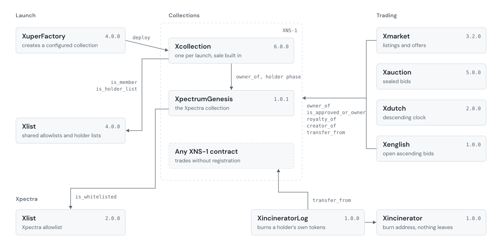

<picture>
  <source media="(prefers-color-scheme: dark)" srcset=".github/assets/banner-contracts-dark.svg">
  
</picture>

**[Marketplace](https://app.xpectrum.xyz)** | [Creators](https://creators.xpectrum.xyz) | [Docs](https://docs.xpectrum.xyz) | [Changelog](./CHANGELOG.md) | [Octrascan](https://octrascan.io)

The contracts behind Xpectrum on Octra mainnet: the NFT standard, the launch factory and its collections, four ways to trade, and the Xpectra collection.
Every file here compiles to the exact bytecode running at its address, and [`scripts/verify.sh`](./scripts/verify.sh) proves it against a node in about a minute, with no wallet and no fee.

## Deployments

Octra mainnet. Every address links to Octrascan.

| Contract | Version | Address | Purpose |
|---|---|---|---|
| [XuperFactory](./contracts/launch/XuperFactory.aml) | 4.0.0 | [`octCzmWD…4rx2nz`](https://octrascan.io/address.html?addr=octCzmWDXWPFWzFhjPXF3rfdeecFPNYedAoRjUyBU4rx2nz) | Creates a configured collection in one transaction |
| [Xcollection](./contracts/launch/Xcollection.aml) | 6.0.0 | one per launch | The collection and its sale, deployed by XuperFactory |
| [Xlist](./contracts/launch/Xlist.aml) | 4.0.0 | [`octBnPAc…y5qiG9`](https://octrascan.io/address.html?addr=octBnPAc1ckgGwXDDHGJcbAFtDb7ttorssqsz54epy5qiG9) | Shared allowlists and holder lists |
| [Xmarket](./contracts/market/Xmarket.aml) | 3.2.0 | [`octGoeTj…VmBj6h`](https://octrascan.io/address.html?addr=octGoeTjaF8MiKTP5ad5FJfWMCZmmEdnrfxTow6UUVmBj6h) | Fixed-price listings, token offers, collection offers |
| [Xauction](./contracts/market/Xauction.aml) | 5.0.0 | [`octBv5yU…16LkUn`](https://octrascan.io/address.html?addr=octBv5yUWMp3D5mAVcvpgC3DWgUGvH8KPMkfsSXv216LkUn) | Sealed-bid auctions |
| [Xdutch](./contracts/market/Xdutch.aml) | 2.0.0 | [`octxD2gf…JjN2s5`](https://octrascan.io/address.html?addr=octxD2gf2i6NDj3XJGBpNNNgiejnUFV1Dk45rNr5fJjN2s5) | Descending-price auctions |
| [Xenglish](./contracts/market/Xenglish.aml) | 1.0.0 | [`oct8p3Uh…W46ipU`](https://octrascan.io/address.html?addr=oct8p3UhGRurjgbfbMERZBENuft4hcodx6DMTJj14W46ipU) | Open ascending auctions |
| [XpectrumGenesis](./contracts/xpectra/XpectrumGenesis.aml) | 1.0.1 | [`octC4PvH…dstZfQ`](https://octrascan.io/address.html?addr=octC4PvHrT8U1vDsZ5ejEBj6UgW2fRoLfohFBSCePdstZfQ) | The Xpectra collection |
| [Xlist](./contracts/xpectra/Xlist.aml) | 2.0.0 | [`oct6hqXn…dKhXzx`](https://octrascan.io/address.html?addr=oct6hqXn2kSm8HptJ3MRmRAbTaY4jvTHH2ntFcSWKdKhXzx) | The Xpectra allowlist |
| [Xincinerator](./contracts/xpectra/Xincinerator.aml) | 1.0.0 | [`octGn3Qw…oaeg6q`](https://octrascan.io/address.html?addr=octGn3QwHTcGjo6Vjz5G9y8Z9hZDsYoA7gbksRqdJoaeg6q) | Burn address |
| [XincineratorLog](./contracts/xpectra/XincineratorLog.aml) | 1.0.0 | [`oct4u3Pm…dPN3zh`](https://octrascan.io/address.html?addr=oct4u3PmynG2jDJADUF1iVTwPA8oxNy2LQTYNKueGdPN3zh) | Burns a holder's own tokens into the burn address |
| [XNS1](./contracts/standard/XNS1.aml) | 4.0.0 | not deployed | Reference implementation of the XNS-1 standard |

Superseded and still on chain: [XuperFactory 2.0.0](./contracts/legacy/XuperFactory.aml) at [`octHgTcv…oSdBVN`](https://octrascan.io/address.html?addr=octHgTcvueQE5LRb2PYLJqa5T9ypUgBuyY5XyxRstoSdBVN) and the [Xcollection 4.0.0](./contracts/legacy/Xcollection.aml) it deploys.
New launches go through 4.0.0.

The same list is machine-readable in [`deployments.json`](./deployments.json), with each contract's bytecode hash and certificate path.

## Architecture

<picture>
  <source media="(prefers-color-scheme: dark)" srcset=".github/assets/architecture-dark.svg">
  
</picture>

Every arrow is a cross-contract call that appears in the source.

**Launch.** `XuperFactory.create_collection` deploys an Xcollection with every setting passed to its constructor, so a collection never exists half configured.
The collection runs its own sale: Xpectra holders first, up to four listed phases, public last.
A paid mint sends the 2.5% platform fee and the creator's proceeds in the same transaction, so the collection holds no OCT between calls.
Listed phases read membership from Xlist, where each collection owns its lists.

**Collections.** Anything that implements XNS-1 can be traded on the four market contracts without registration.
Xcollection and XpectrumGenesis are the two implementations in production.

**Trading.** Xmarket, Xauction, Xdutch and Xenglish read ownership, approval, creator and royalty from the collection and move the token with `transfer_from`.
Each takes a 2.5% fee and pays the collection's royalty, capped at 10%, at settlement.
Proceeds, royalties and refunds are credited inside the market contract and withdrawn with `claim_proceeds`.

## XNS-1

XNS-1 is the token interface every Xpectrum collection speaks.
The market contracts depend on five entry points, and these must match exactly:

| Entry point | Signature | Returns |
|---|---|---|
| `owner_of` | `(token_id: u128)` | the owner |
| `is_approved_or_owner` | `(token_id: u128, addr: address)` | `u128`, `1` or `0` |
| `creator_of` | `(token_id: u128)` | the royalty recipient |
| `royalty_of` | `(token_id: u128)` | `u128` basis points, at most `1000` |
| `transfer_from` | `(from: address, to: address, token_id: u128)` | moves the token |

`is_approved_or_owner` returns `u128`, not `bool`.
Settlement runs `require(approved == 1)`, which a `bool` can never satisfy, so a contract that returns `bool` compiles, verifies and then fails every sale.
It takes `token_id` first and the address second.

Xmarket and Xauction also accept collections shaped like ERC-721 through a standard-mode lane, which checks `owner_of` and `get_approved` instead.
The owner enables it per collection.

[`XNS1.aml`](./contracts/standard/XNS1.aml) is a complete reference implementation with burn, operators, a one-way provenance hash and circle resource pointers.
It is not deployed and exists to be read and copied.

## Repository layout

```
contracts/
  standard/   XNS1                                    the interface, as a reference implementation
  launch/     XuperFactory, Xcollection, Xlist        launching a collection
  market/     Xmarket, Xauction, Xdutch, Xenglish     trading any XNS-1 contract
  xpectra/    XpectrumGenesis, Xlist, Xincinerator,   the Xpectra collection and its burn path
              XincineratorLog
  legacy/     XuperFactory 2.0.0, Xcollection 4.0.0   superseded, still deployed
verification/  one certificate per source, same layout
deployments.json
scripts/verify.sh
```

A source file is named for its contract and carries no version; the version lives in the certificate name, the source header and the changelog.
Three contracts declare a different identifier from their filename, because the identifier is compiled into deployed bytecode and cannot change without a redeploy: `Xmarket.aml` declares `Xmarket_v3`, `Xauction.aml` declares `Xauction_v2` and `xpectra/Xlist.aml` declares `Xlist_v2`.

`launch/XuperFactory.aml` is the mainnet build.
The factory embeds the compiled Xcollection as a constant, and the compiler produces different bytecode on devnet and mainnet for the same source, so a devnet build of the factory differs in that one constant.

## Verifying

```sh
scripts/verify.sh           # recompile every source and compare it with its certificate
scripts/verify.sh --live    # also compare each deployed contract with the code running on chain
```

Requires `curl` and `jq`.
Compilation is a free read on any Octra node and needs no wallet.
Exit status 0 means every source matches.

A single file can be checked by hand:

```sh
curl -s https://octra.network/rpc \
  -H 'Content-Type: application/json' -H 'Origin: https://octra.network' -H 'User-Agent: Mozilla/5.0' \
  -d "$(jq -Rs '{jsonrpc:"2.0",id:1,method:"octra_compileAml",params:[.,true]}' contracts/market/Xmarket.aml)" \
  | jq -r .result.certificate.bytecode_hash
# 943cbd42f67c2d704c1ec7b1f01facc1a59024a4ce79db7afc8686baeec60e66

curl -s https://octra.network/rpc \
  -H 'Content-Type: application/json' -H 'Origin: https://octra.network' -H 'User-Agent: Mozilla/5.0' \
  -d '{"jsonrpc":"2.0","id":1,"method":"vm_contract","params":["octGoeTjaF8MiKTP5ad5FJfWMCZmmEdnrfxTow6UUVmBj6h"]}' \
  | jq -r .result.code_hash
# 943cbd42f67c2d704c1ec7b1f01facc1a59024a4ce79db7afc8686baeec60e66
```

Mainnet refuses requests without browser headers and answers with an HTML error page instead of JSON, which is why both calls send `Origin` and `User-Agent`.

Compare `bytecode_hash`, not `source_hash`.
Comments do not change bytecode, so `source_hash` moves on a documentation edit while `bytecode_hash` stays fixed.

### Verifier report

Every contract passes Octra's AML safety verifier (`aml_safety_report_v1`) with 0 errors.
The full report for each is in [`verification/`](./verification/).

| Contract | Warnings | Flagged parameters |
|---|---|---|
| XuperFactory 4.0.0 | 2 | `create_collection.max_supply`, `set_launch_fee.fee` |
| Xcollection 6.0.0 | 6 | `mint.quantity` and five `token_id` parameters |
| Xlist 4.0.0 | 0 | |
| Xmarket 3.2.0 | 0 | |
| Xauction 5.0.0 | 6 | three bid `amount` parameters, three `auction_id` parameters |
| Xdutch 2.0.0 | 1 | `reclaim.sale_id` |
| Xenglish 1.0.0 | 1 | `bid.amount` |
| XpectrumGenesis 1.0.1 | 4 | four `token_id` parameters |
| Xlist 2.0.0 | 0 | |
| Xincinerator 1.0.0 | 0 | |
| XincineratorLog 1.0.0 | 2 | `burn_range.start_id`, `token_is_burned.token_id` |
| XNS1 4.0.0 | 7 | `mint.royalty_bps` and six `token_id` parameters |

Every warning is `unsigned_parameter_without_positive_guard`, which flags an unsigned parameter that could be zero in a function whose name suggests value moves.
Each one has been checked against the code.
Token, sale and auction ids start at 0, so zero is a valid id.
`quantity` and `max_supply` are checked inside a helper or the collection constructor, which the verifier does not follow.
Bid amounts are checked against the auction's minimum or the sealed commitment.
A royalty or launch fee of zero is allowed on purpose.

## Reading the source

Every public function carries a block in Prism, Xpectrum's comment format. This is `Xdutch.open_sale`:
`//|` lines are documentation; the compiler reads them as ordinary comments.

```
//| Lists a token and takes it into escrow.
//| who      the token's owner, who has approved this contract for it
//| holds    the token moves into this contract
//| reveals  the seller, the token and every sale term
//| logs     Listed(sale_id, seller, nft, token_id, start, floor)
//| in       nft       collection address
//| in       token_id  token
//| in       start     opening price
//| in       floor     lowest price
//| in       step      price decrease per epoch
//| in       duration  length in epochs
//| in       gated     1 for allowlisted buyers only, which refuses everyone until add_allow loads the list
//| out      sale id
fn open_sale(nft: address, token_id: u128, start: u128, floor: u128, step: u128, duration: u128, gated: u128): u128
```
| Band | Meaning |
|---|---|
| `who` | who may call it |
| `pays` | value attached or paid out |
| `when` | the epoch window it works in |
| `holds` | where the token goes |
| `reveals` | what the call makes public on chain |
| `logs` | the event written |
| `in`, `out` | each parameter, and the return with its field order |

Each contract header states its custody, payout and privacy model in the same way.
Amounts are in micro-OCT (1 OCT = 1,000,000) and time is in epochs throughout.

## Changelog

[CHANGELOG.md](./CHANGELOG.md) lists every version with its impact on callers.
Contracts are immutable once deployed, so any change ships as a new deployment with a new version.

## License

Contracts first published here under MIT remain MIT.
Contracts whose header carries `SPDX-License-Identifier: FSL-1.1-MIT` are under the Functional Source License 1.1 with MIT as the future license, and each becomes MIT two years after it was published, on the date in its header.
See [LICENSE](./LICENSE).
